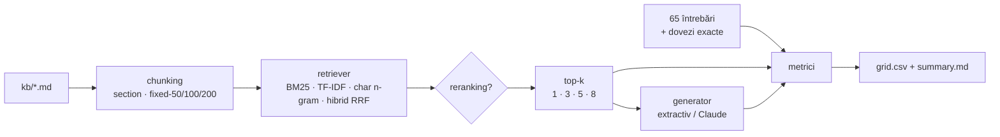

# 🔬 rag-eval-lab

Un laborator care răspunde cu cifre la întrebările pe care le ridică orice RAG:
**ce chunk size? câte fragmente (top-k)? merită reranking-ul? ce embeddings?**

Corpus: 12 documente de politici ale unui magazin online fictiv (TechNova, Moldova), în română.
Set de evaluare: **65 de întrebări** cu răspuns de referință și pasaje-dovadă localizate exact în text.
Grila: 4 strategii de chunking × 4 retriever-e × cu/fără reranking × 4 valori de k = **128 de configurații**, evaluate în ~11 secunde, offline.

> Pasul 3 din planul meu de studiu: RAG serios + evaluare. Scopul e să pot justifica alegerile cu cifre, nu cu „așa se face”.


## Rezultatul pe scurt

**Configurația aleasă:** chunking pe secțiuni · hibrid (BM25 + char n-gram, RRF) · fără reranking · **k = 3**

| | hit@3 | MRR | context recall | tokeni context | $ / 1000 întrebări* |
|---|---:|---:|---:|---:|---:|
| aleasă: `section | hybrid | k=3` | 0.950 | 0.872 | 0.950 | 304 | 0.92 |
| mai ieftină: `section | hybrid | k=1` | 0.800 | 0.800 | 0.794 | 153 | 0.56 |
| mai sigură: `section | hybrid | k=5` | 0.983 | 0.880 | 0.983 | 450 | 1.21 |
| chunk-uri mari: `fixed-200 | hybrid | k=3` | 1.000 | 0.925 | 0.994 | 874 | 2.05 |

\* cost estimat al generării cu Claude Sonnet 5.5 ($2 / $10 per 1M tokeni), plus un system prompt de 60 de tokeni.

**De ce asta:**
1. **k = 3 e „cotul” curbei.** De la k=1 la k=3, hit-ul crește cu 15 puncte (0.80 → 0.95) pentru +151 de tokeni. De la 3 la 5 mai câștigăm 3.3 puncte, dar plătim cu 48% mai mulți tokeni.
2. **Chunk-urile mari (200 de cuvinte) au cel mai bun retrieval** (hit@3 = 1.0), dar trimit de **2.9 ori** mai mult context. Pe un corpus mic, un chunk de 200 de cuvinte e aproape jumătate de document. Costul crește și modelul primește mult text irelevant: context precision 0.38 la chunk-uri mari, față de 0.32 pe secțiuni, la de 3 ori mai mulți tokeni.
3. **Secțiunile sunt unitatea naturală.** Fiecare secțiune `##` tratează un singur subiect, deci chunk-ul nu taie un răspuns în două. Media pe grilă: answer recall 0.625 pe secțiuni, față de 0.571 pe ferestre de 50 de cuvinte.
4. **Hibridul câștigă la MRR** (0.872 față de 0.842 pentru BM25 singur, la k=3). Char n-gram prinde formele flexionate pe care stemming-ul prin prefix le ratează, iar BM25 prinde termenii exacți (sume, nume de produse).

## Ce nu a mers (și e la fel de important)

- **Reranker-ul lexical strică ordinea.** MRR mediu scade de la 0.861 la 0.826, iar hit@k de la 0.939 la 0.919. Reranker-ul meu face doar overlap de termeni + proximitate. Nu „înțelege” parafrazele mai bine decât retriever-ul hibrid, deci doar amestecă un clasament deja bun. **Concluzie:** reranking-ul are sens doar cu un cross-encoder real (de ex. `bge-reranker-v2-m3`). Interfața e pregătită pentru el: `RerankedRetriever`.
- **Generatorul extractiv e veriga slabă.** Retrieval-ul găsește dovada în 95–98% din cazuri, dar answer recall rămâne ~0.64. Iar la întrebările fără răspuns, refuzul pe bază de prag lexical prinde doar 1 din 5 la pragul ales:

  | prag | refuz corect (fără răspuns) | refuz greșit (cu răspuns) | answer recall |
  |---:|---:|---:|---:|
  | 0.30 | 0.20 | 0.033 | 0.681 |
  | 0.40 *(ales)* | 0.20 | 0.117 | 0.644 |
  | 0.50 | 0.40 | 0.217 | 0.592 |
  | 0.70 | 0.60 | 0.367 | 0.503 |

  Nu există un prag bun: ca să refuze corect 3 din 5, refuză greșit 37% din întrebările legitime. **Concluzie:** decizia „nu știu” cere un model care înțelege întrebarea. `ClaudeGenerator` întoarce `{answer, abstain}` cu output structurat. Următorul experiment e grila pe generatorul Claude.
- **Parafrazele sunt cele mai grele:** hit@3 pe secțiuni = 0.875 la BM25, 0.812 la char n-gram și 0.938 la TF-IDF, față de ~1.0 la întrebările directe. Aici ar ajuta cel mai mult embeddings neurale (`SentenceTransformerEmbedder`, opțional).

Raportul complet, cu top 10, frontiera Pareto calitate–cost și efectul fiecărei dimensiuni, e în [`results/summary.md`](results/summary.md). Toate cele 128 de rânduri sunt în [`results/grid.csv`](results/grid.csv).

## Cum se măsoară



**Dovezile sunt intervale de caractere, nu „chunk-ul corect”.** Fiecare întrebare are 1–2 fraze copiate exact din documente (`data/questions.jsonl`). La încărcare, fiecare frază e localizată în corpus, iar un test pică dacă o frază lipsește sau apare de două ori. Metricile compară intervalele chunk-urilor cu intervalele dovezilor, așa că **același set de evaluare merge pentru orice strategie de chunking**, fără să fie refăcut.

| Metrică | Ce măsoară |
|---|---|
| hit@k | există în top k un chunk care acoperă ≥ 50% dintr-o dovadă |
| MRR | 1 / rangul primului chunk relevant |
| context precision | ce fracție din chunk-urile trimise atinge o dovadă |
| context recall | ce fracție din caracterele dovezilor ajunge în context |
| answer recall | ce fracție din cuvintele de conținut ale răspunsului de referință apare în răspuns |
| answer F1 | token F1 față de referință (ca la SQuAD) |
| refuz corect / greșit | refuzuri la întrebările fără răspuns / la cele cu răspuns |
| $ / 1k întrebări | (tokeni context × preț input + tokeni răspuns × preț output) × 1000 |

**Tipuri de întrebări:** 37 directe, 16 parafrazate (fără cuvintele din document: *„Mi-a căzut telefonul în apă. Intră în garanție?”*), 4 de contrast (retur 30 de zile online vs. 14 în magazin), 3 cu mai multe dovezi și 5 fără răspuns în documentație.

## Pornire

```bash
git clone https://github.com/cs1lyuha/rag-eval-lab.git
cd rag-eval-lab
python3 -m venv .venv && source .venv/bin/activate
pip install -r requirements.txt

pytest -q                                   # 57 de teste, inclusiv praguri minime de calitate
python -m rag_lab.experiment                # grila completă → results/
python -m rag_lab.experiment --config "section|hybrid|no-rerank|3"

# cu Claude ca generator (cere ANTHROPIC_API_KEY)
pip install anthropic
python -m rag_lab.experiment --generator claude --config "section|hybrid|no-rerank|3"
```

## Structura

| Fișier | Rol |
|---|---|
| `rag_lab/corpus.py` | încărcare `kb/*.md`, secțiuni cu id-uri stabile (`livrare#costul-livrarii`) |
| `rag_lab/chunking.py` | ferestre fixe cu overlap 20%, pe secțiuni, contextual headers opționale |
| `rag_lab/text.py` | normalizare pentru română: fără diacritice, stopwords, stemming prin prefix |
| `rag_lab/embeddings.py` | TF-IDF, char n-gram cu feature hashing, adaptor opțional sentence-transformers |
| `rag_lab/retrieval.py` | căutare densă (cosinus), BM25, hibrid RRF, reranker lexical |
| `rag_lab/dataset.py` | setul de evaluare + localizarea exactă a dovezilor |
| `rag_lab/metrics.py` | toate metricile de mai sus |
| `rag_lab/generation.py` | generator extractiv cu prag de refuz; `ClaudeGenerator` cu `{answer, abstain}` |
| `rag_lab/experiment.py` | grila, analiza pe tipuri de întrebări, pragul de refuz |
| `rag_lab/report.py` | raport Markdown, frontiera Pareto |

## Limitări

- Corpusul e mic (12 documente, 59 de secțiuni), deci hit@k e ridicat pentru toate configurațiile. Pe un corpus de mii de documente diferențele dintre retriever-e ar fi mai mari.
- Costul folosește o estimare de ~4 caractere pe token, nu tokenizer-ul real. Pentru cifre exacte: `client.messages.count_tokens`.
- Faithfulness e calculat în CSV, dar la generatorul extractiv e trivial 1.0, pentru că răspunsul e copiat din context. Devine relevant abia cu generatorul Claude.
- Ragas nu e folosit direct: metricile de retrieval sunt implementate de mână, ca să fie deterministe și să ruleze în CI fără API.

## Ce urmează

- [ ] Grila pe `ClaudeGenerator` + LLM-as-judge pentru faithfulness
- [ ] Embeddings neurale (`multilingual-e5-small`) și cross-encoder pentru reranking
- [ ] Mutarea în PostgreSQL + pgvector (HNSW) și comparația latenței cu numpy
